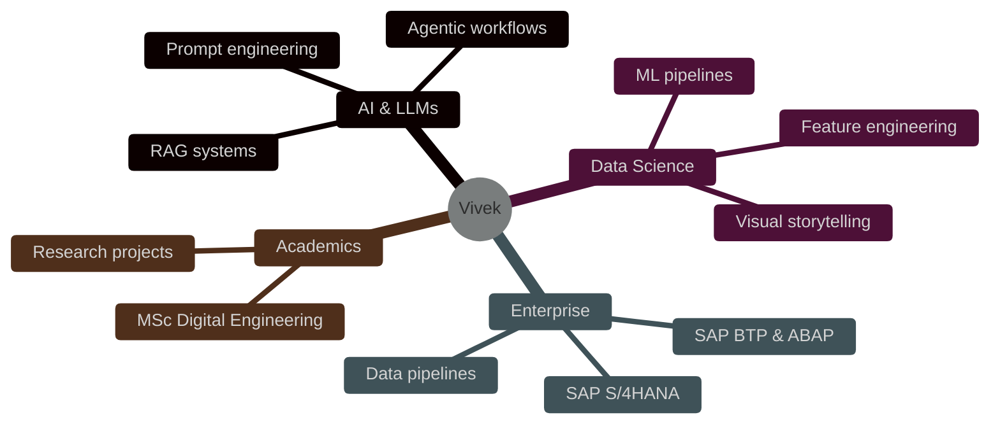

<div align="center">


[](https://git.io/typing-svg)

<br/>

[](https://www.linkedin.com/in/vivek-singh-817a77195)
[](https://portfolio-vert-two-02fklhfwlr.vercel.app/)
[](mailto:vivekkumarsingh1911@gmail.com)

[](https://github.com/VivekSinghK14?tab=followers)

</div>

---

## 👨‍💻 About Me

```python
class VivekSingh:
    def __init__(self):
        self.role      = ["AI Engineer", "Data Scientist", "LLM Explorer"]
        self.studying  = "M.Sc. Digital Engineering @ Otto-von-Guericke University, Germany"
        self.background = "B.Tech Computer Science & Engineering"
        self.experience = "AI solutions for SAP HANA clients | ABAP on SAP BTP"
        self.focus     = ["LLMs & RAG", "Deep Learning", "Scalable ML Pipelines", "Data Storytelling"]
        self.motto     = "Turning Data into Intelligence"

    def open_to(self):
        return ["AI/ML internships & working-student roles", "Research collaborations", "Open-source projects"]
```

<table>
<tr>
<td width="60%">

### 🚀 Highlights

- 🎓 **M.Sc. Digital Engineering** (current grade **1.7** 🇩🇪)
- 🏢 Architected **AI solutions for 5+ SAP HANA clients** (2024)
- 📜 Certified in **Configuring ABAP on SAP BTP**, applied across 3+ enterprise projects (2023–2024)
- ⚡ Delivered **scalable ML pipelines** and enterprise-grade data workflows
- 🧠 Exploring **LLMs, RAG and agentic workflows**

</td>
<td width="40%" align="center">


</td>
</tr>
</table>

---

## 🧠 Tech Stack

<div align="center">

### Languages & Core


### AI / ML / Data


### Visualization & BI


### DevOps & Tools


</div>

<details>
<summary><b>📚 Full skill breakdown (click to expand)</b></summary>
<br/>

| Area | Tools & Concepts |
|---|---|
| **Machine Learning** | Scikit-Learn, feature engineering, model evaluation, pipelines |
| **Deep Learning** | PyTorch, TensorFlow, neural networks |
| **LLMs** | Prompt engineering, RAG, fine-tuning concepts, LLM applications |
| **Data Engineering** | SQL, PostgreSQL, ETL, data pipelines, SAP S/4HANA |
| **Visualization** | Matplotlib, Seaborn, Power BI, data storytelling |
| **Engineering** | Git, Docker, Maven, ABAP on SAP BTP |

</details>

---

## 🔭 What I'm Working On



---

## 📌 Featured Projects

> 💡 **Tip:** Replace the placeholders below with your best repositories.

<div align="center">

<!-- Replace "YOUR-REPO-1" etc. with your real repo names -->
<a href="https://github.com/VivekSinghK14/YOUR-REPO-1">
  
</a>
<a href="https://github.com/VivekSinghK14/YOUR-REPO-2">
  
</a>
<a href="https://github.com/VivekSinghK14/YOUR-REPO-3">
  
</a>
<a href="https://github.com/VivekSinghK14/YOUR-REPO-4">
  
</a>

</div>

---

## 🏆 Achievements & Education

<table>
<tr>
<td width="50%" valign="top">

### 🏅 Achievements
- 🚀 AI solutions for **5+ SAP HANA clients** (2024)
- 📜 **ABAP on SAP BTP** certified, 3+ enterprise projects (2023–2024)
- ⚡ Scalable ML pipelines & enterprise data workflows

</td>
<td width="50%" valign="top">

### 🎓 Education
**M.Sc. Digital Engineering**
Otto-von-Guericke University, Germany
*Current grade: 1.7*

**B.Tech Computer Science & Engineering**
Abdul Kalam Technical University, India
*80%*

</td>
</tr>
</table>

---

## 📊 GitHub Analytics

<div align="center">


<br/>


<br/>


</div>

---

## 🐍 Contribution Snake

<div align="center">

<picture>
  <source media="(prefers-color-scheme: dark)" srcset="https://raw.githubusercontent.com/VivekSinghK14/VivekSinghK14/output/github-snake-dark.svg"/>
  <source media="(prefers-color-scheme: light)" srcset="https://raw.githubusercontent.com/VivekSinghK14/VivekSinghK14/output/github-snake.svg"/>
  
</picture>

</div>

---

## 📫 Let's Connect

<div align="center">

| Platform | Link |
|:---:|:---:|
| 🔗 **LinkedIn** | [vivek-singh-817a77195](https://www.linkedin.com/in/vivek-singh-817a77195) |
| 🌐 **Portfolio** | [portfolio-vert-two-02fklhfwlr.vercel.app](https://portfolio-vert-two-02fklhfwlr.vercel.app/) |
| 📧 **Email** | [vivekkumarsingh1911@gmail.com](mailto:vivekkumarsingh1911@gmail.com) |

<br/>


</div>
